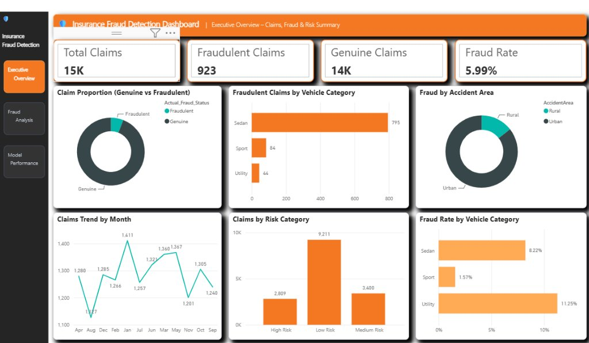
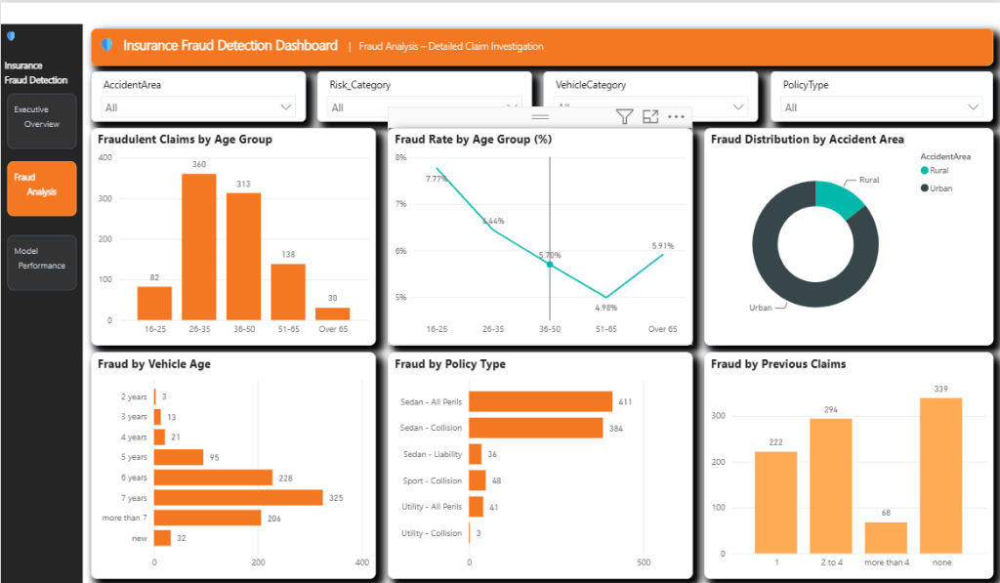
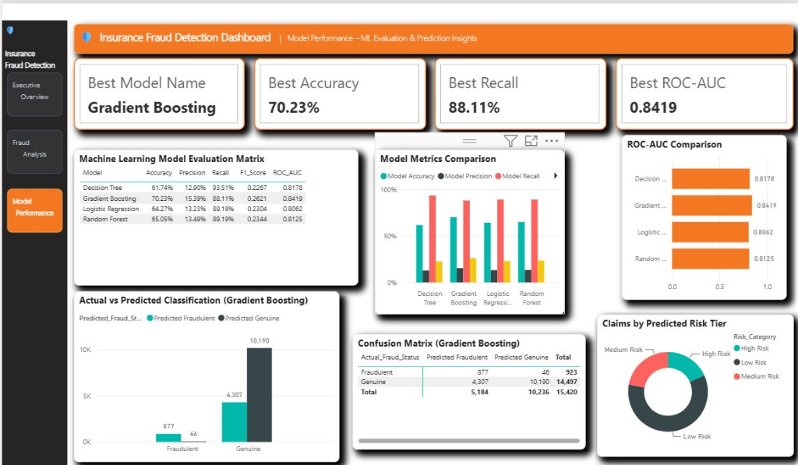

# Vehicle Insurance Claim Fraud Detection

[](https://www.python.org/)
[](https://scikit-learn.org/)
[](https://powerbi.microsoft.com/)
[](LICENSE)

An end-to-end Data Science and Business Intelligence project designed to detect fraudulent vehicle insurance claims. This project integrates a complete **Machine Learning** pipeline in Python with a comprehensive 3-page interactive report in **Microsoft Power BI**.

---

## 📌 Project Overview

Vehicle insurance fraud costs insurance providers billions annually. Detecting fraudulent claims is challenging due to extreme class imbalance (less than 6% of claims are fraudulent). A naive model that classifies all claims as legitimate would achieve ~94% accuracy while failing to detect any fraud.

This project addresses this challenge by:
1. Cleaning and preprocessing real-world claim data with anomaly handling.
2. Handling severe class imbalance (~15:1 ratio) through balanced sample weighting.
3. Training and comparatively evaluating four classification algorithms.
4. Exporting scored risk tiers (`Low Risk`, `Medium Risk`, `High Risk`) to power an interactive Power BI dashboard for decision-makers and fraud investigators.

---

## 🏗️ Repository Structure

```text
├── dataset/
│   └── fraud_oracle.csv                  # Vehicle claims dataset (15,420 records)
├── docs/
│   └── Insurance_Claim_Fraud_Detection_Report.docx  # Comprehensive final report
├── imgs/
│   ├── dashboard_executive_overview.png  # Dashboard Page 1 preview
│   ├── dashboard_fraud_analysis.png      # Dashboard Page 2 preview
│   └── dashboard_model_performance.png   # Dashboard Page 3 preview
├── outputs/
│   ├── fraud_predictions.csv             # Full predictions with probabilities & risk tiers
│   └── model_comparison.csv              # Benchmark metrics across all models
├── powerbi/
│   ├── Insurance_Fraud_Dashboard.pbix    # Main Power BI Desktop dashboard file
│   ├── Insurance_Fraud_Dashboard.pbip    # Power BI Project format
│   ├── DAX_Measures.dax                  # Reusable DAX measure library
│   ├── PowerQuery_Scripts.m              # Power Query (M) transformations
│   └── README.md                         # Dashboard documentation and guide
├── main.py                               # Machine learning pipeline script
├── requirements.txt                      # Project dependencies
├── .gitignore                            # Standard git exclusions
└── README.md                             # Project documentation
```

---

## ⚙️ Quick Start

### 1. Prerequisites
Ensure you have Python 3.9+ installed.

### 2. Install Dependencies
```bash
pip install -r requirements.txt
```

### 3. Run the Machine Learning Pipeline
```bash
python main.py
```
This executes:
- Anomaly correction (dates and driver ages).
- Standard scaling of numeric features and one-hot encoding of categorical features.
- Stratified 80/20 train/test splitting.
- Training and evaluation of **Logistic Regression**, **Decision Tree**, **Random Forest**, and **Gradient Boosting**.
- Export of `outputs/model_comparison.csv` and `outputs/fraud_predictions.csv`.

### 4. Open the Power BI Dashboard
Open `powerbi/Insurance_Fraud_Dashboard.pbix` directly in **Power BI Desktop** to explore the interactive visualizations, slicers, and KPI cards.

---

## 📊 Machine Learning Model Comparison

All models were evaluated on an isolated 20% stratified test split. Because catching fraud is the primary business priority, **Recall** and **ROC-AUC** served as the key selection criteria.

| Algorithm | Accuracy | Precision | Recall | F1-Score | ROC-AUC |
| :--- | :---: | :---: | :---: | :---: | :---: |
| **Gradient Boosting (Champion)** | **70.23%** | **15.39%** | **88.11%** | **0.2621** | **0.8419** |
| **Random Forest** | 65.05% | 13.49% | 89.19% | 0.2344 | 0.8125 |
| **Logistic Regression** | 64.27% | 13.23% | 89.19% | 0.2304 | 0.8062 |
| **Decision Tree** | 61.74% | 12.90% | 93.51% | 0.2267 | 0.8178 |

> **Key Finding:** **Gradient Boosting** achieved the highest **ROC-AUC (0.8419)** and **F1-Score (0.2621)** while capturing **88.11%** of fraudulent claims in the test set.

---

## 📈 Power BI Interactive Dashboard

The dashboard consists of three purpose-built report pages:

### Page 1: Executive Overview
High-level summary for leadership, displaying overall claims volume, genuine vs. fraudulent claims distribution, and claim segments by vehicle category and accident location.



### Page 2: Fraud Analysis & Risk Demographics
Granular investigation view equipped with interactive slicers (Accident Area, Risk Category, Vehicle Category). Visualizes fraud rates by driver age group, vehicle age, policy coverage, and past claim history.



### Page 3: Model Performance & Validation
Technical evaluation page displaying the live model comparison matrix, multi-metric performance charts, and claim distribution grouped by predicted fraud probability and risk tiers.



---

## 💡 Key Business Insights

- **Accident Area:** Claims originating in urban areas represent the vast majority of fraudulent activities, requiring targeted investigation workflows.
- **Driver Age Group:** Drivers aged 16–25 and over 65 exhibit distinct risk profiles and higher claim frequency.
- **Vehicle Type:** Sedans account for the highest total volume of fraud incidents, while Sport vehicles show higher severity per claim.
- **Past Claim History:** Policyholders with multiple prior claims represent an elevated fraud risk tier compared to first-time claimants.

